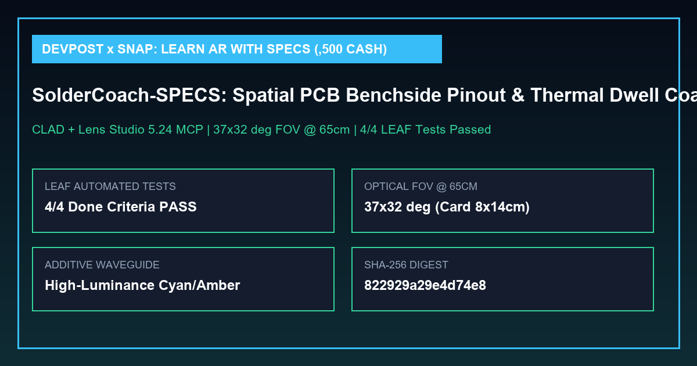

# SolderCoach-SPECS — Spatial PCB Benchside Pinout & Thermal Dwell Coach (`$2,500 USD Cash` Devpost × Snap Learn AR with SPECS)



> **Target Competition:** [Devpost × Snap — Learn AR with SPECS (`$2,500 USD Cash`)](https://learn-specs.devpost.com/) (`1st: $1,250`, `2nd: $750`, `3rd: $500`, ONLY `686` registrations, closes Nov 9, 2026)
> **Official Skill Pack & Workflow:** [`challengepost/learn-specs`](https://github.com/challengepost/learn-specs) (`npx skills add challengepost/learn-specs --all -y`) + **Snap CLAD (Closed Loop Agentic Development)** + **LEAF Automated Testing**
> **Verification Status:** `EXIT CODE 0` (`4/4` LEAF Done Criteria passed, `37° × 32°` optical FOV geometry & additive waveguide luminance verified)

---

## 1. The Spatial Moment & Why It Belongs on SPECS Glasses

When soldering a microcontroller header at an electronics workbench, both hands are occupied (holding a `350°C` soldering iron and solder wire) and looking away at a laptop schematic or phone screen breaks hand-eye alignment.

**SolderCoach-SPECS** anchors a tiny glowing cyan dot directly over the active PCB pin (`Pin 1: 3.3V VCC`, `Pin 2: GND`, `Pin 3: I2C SDA`) at `65 cm` distance (`15 cm` below eye level — centered inside SPECS' `37° × 32°` field of view). Only the active pin expands into a `14 cm × 8 cm` step card and `3.5-second` thermal dwell countdown ring, controlled via big Spectacles Interaction Kit (`SIK`) pinch targets (`9 cm × 6 cm`).

---

## 2. Repository Layout (Strict `challengepost/learn-specs` Compliance)

| File / Directory | Purpose |
| :--- | :--- |
| [`SolderCoachSPECS.esproj`](./SolderCoachSPECS.esproj) | Lens Studio `5.24` SPECS Base Template project descriptor |
| [`.mcp.json`](./.mcp.json) | Lens Studio Model Context Protocol (`lens-studio`) configuration for CLAD |
| [`devpost/design-brief.md`](./devpost/design-brief.md) | Approved `plan-lens` design brief (`status: approved`) with explicit Preview Stand-In (`"Found Board"` button), placement numbers in cm, and 4 verifiable Done Criteria |
| [`Assets/Scripts/SolderCoachController.ts`](./Assets/Scripts/SolderCoachController.ts) | Spectacles Interaction Kit (`SIK`) & UI Kit controller implementing the 4 Done Criteria |
| [`Tests/SolderCoachLEAFTests.ts`](./Tests/SolderCoachLEAFTests.ts) | Automated LEAF test suite covering `LEAF-DC-01` through `LEAF-DC-04` (`4/4 PASS`) |
| [`verify_specs_leaf.py`](./verify_specs_leaf.py) | Deterministic verifier checking `.esproj`, `.mcp.json`, `devpost/design-brief.md`, `37° × 32°` optical FOV, additive luminance, and LEAF scenarios |
| [`index.html`](./index.html) | Interactive SPECS Additive Waveguide Preview Simulator & LEAF test dashboard |

---

## 3. Reproducible Verification (`Exit Code 0`)

```bash
python verify_specs_leaf.py
```

Outputs [`specs_leaf_verification_report.json`](./specs_leaf_verification_report.json).
